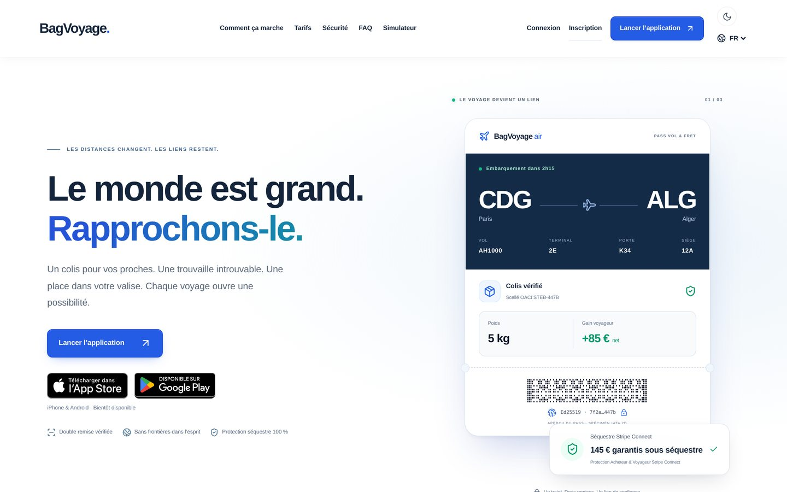
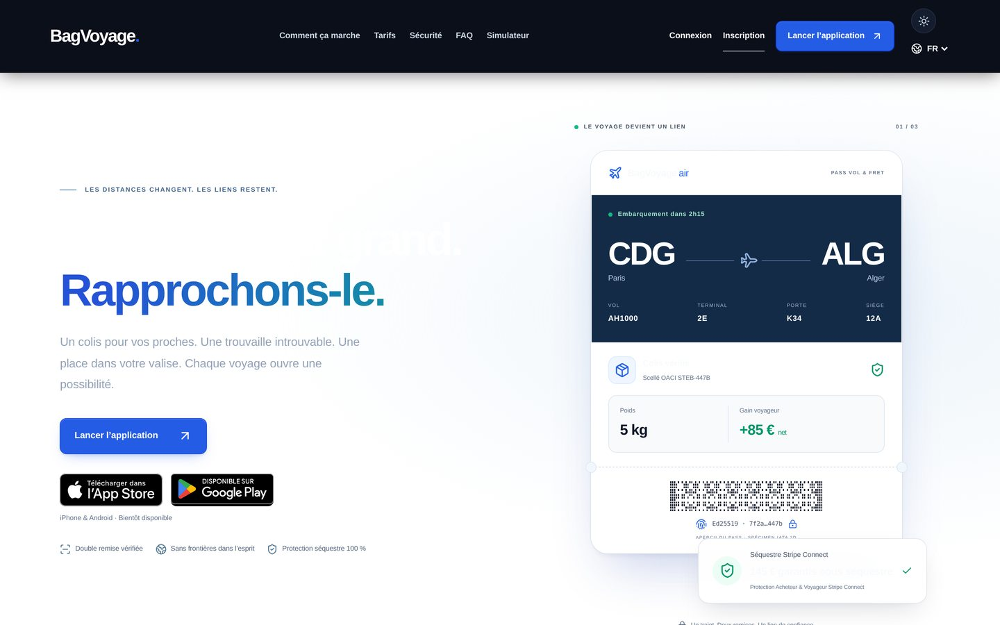
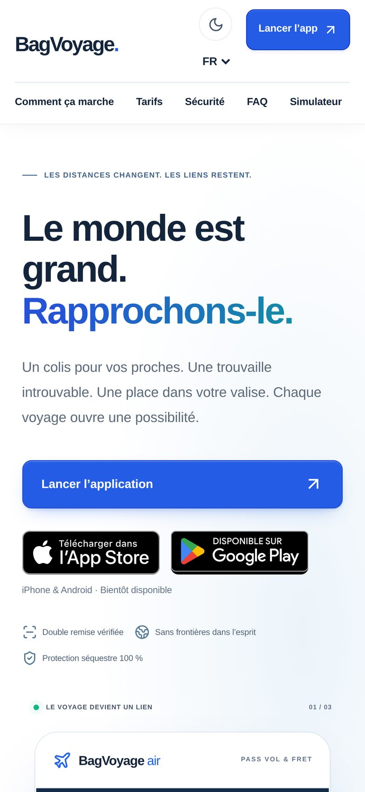
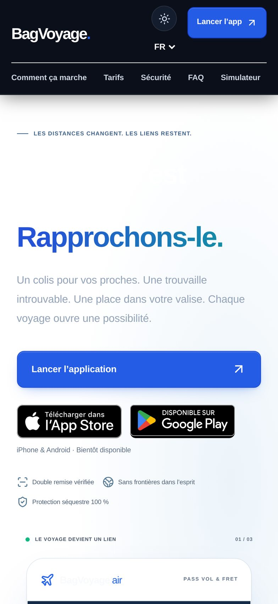
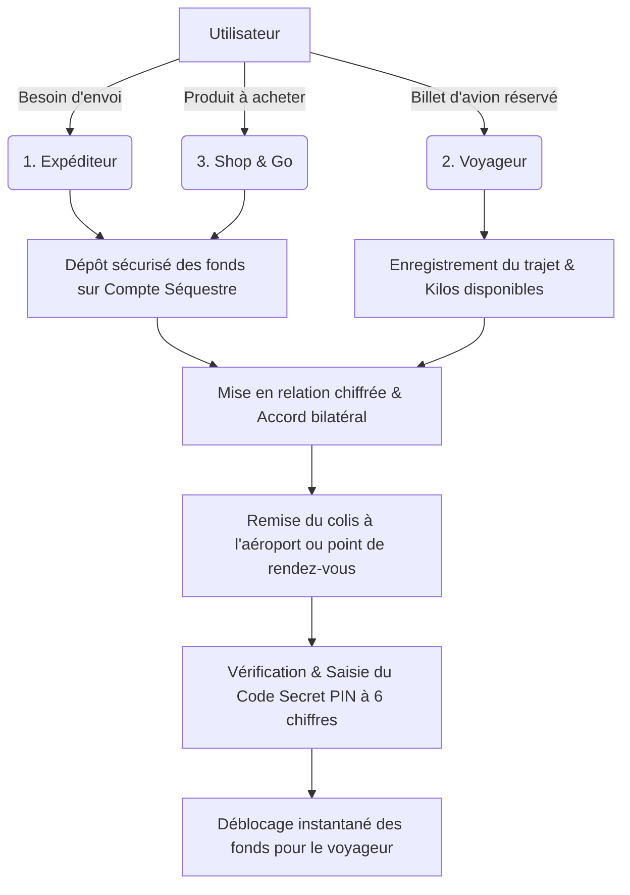
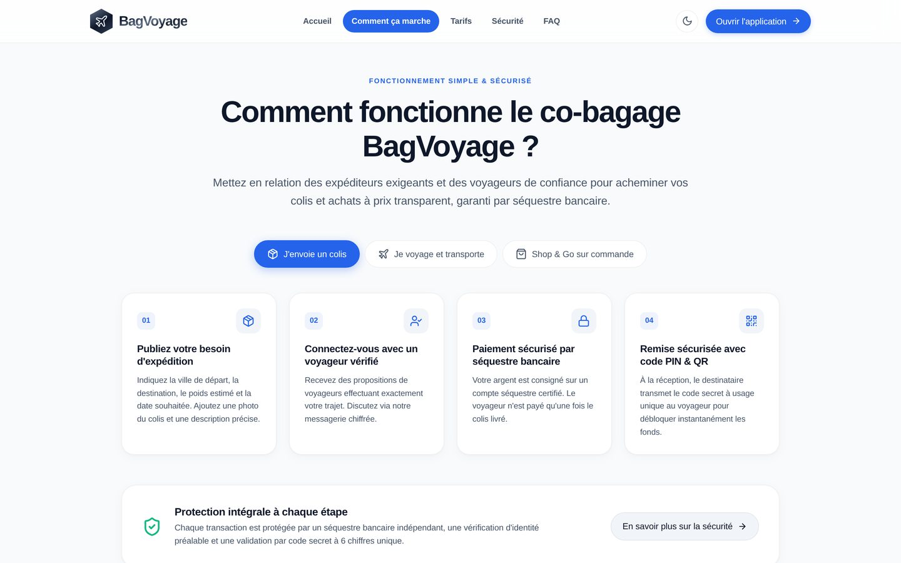
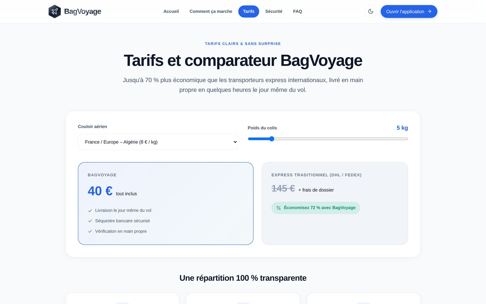
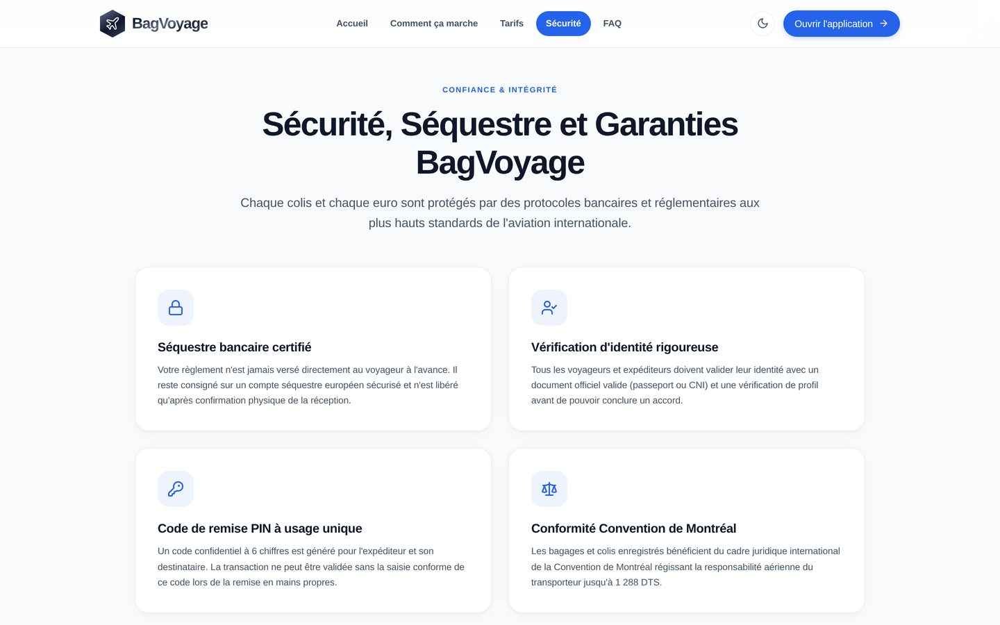
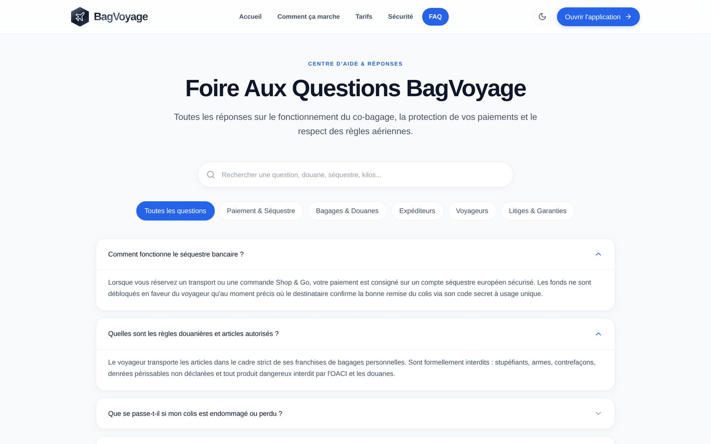

# BagVoyage — Plateforme Collaborative de Co-colisage & Shop & Go

**La première plateforme internationale de transport collaboratif de colis et de shopping assisté par voyageurs vérifiés.**

[Consulter le Dossier Client PDF (5.2 Mo)](./BagVoyage_Dossier_Client.pdf) • [Architecture SEO Dédiée](#5-architecture-seo--pages-dédiées) • [Grille Tarifaire](#6-grille-tarifaire--comparatif-marché)

---

## Sommaire

1. [Présentation & Proposition de Valeur](#1-présentation--proposition-de-valeur)
2. [Design System Apple Pro : Desktop & Mobile (Clair / Sombre)](#2-design-system-apple-pro--desktop--mobile)
3. [Les 3 Parcours Utilisateurs](#3-les-3-parcours-utilisateurs)
4. [Fonctionnalités Majeures & Sécurité Embarquée](#4-fonctionnalités-majeures--sécurité-embarquée)
5. [Architecture SEO & Pages Dédiées](#5-architecture-seo--pages-dédiées)
6. [Grille Tarifaire & Comparatif Marché](#6-grille-tarifaire--comparatif-marché)
7. [Architecture Technique & Stack](#7-architecture-technique--stack)
8. [Vérifications & Tests de Qualité](#8-vérifications--tests-de-qualité)

---

## 1. Présentation & Proposition de Valeur

BagVoyage résout le défi du coût prohibitif et des lenteurs du fret express traditionnel (DHL, FedEx, UPS) sur les corridors internationaux (notamment France–Algérie, Canada, Moyen-Orient, Afrique).

- **Pour l'Expéditeur** : Expédiez vos colis urgents ou volumineux à partir de **8 €/kg**, soit jusqu'à **70% moins cher** que les transporteurs express, avec remise en mains propres en moins de 48h.
- **Pour le Voyageur** : Rentabilisez vos franchises bagages aériennes inexploitées en percevant **85% du montant net** de la transaction (jusqu'à 250 € par voyage).
- **Pour l'Acheteur (Shop & Go)** : Commandez des produits indisponibles localement (médicaments autorisés, high-tech, mode) achetés directement en magasin par un voyageur de confiance.

---

## 2. Design System Apple Pro : Desktop & Mobile

L'application a été entièrement conçue selon les principes ergonomiques d'Apple (Human Interface Guidelines) : typographie sans empattement ultra-lisible, micro-interactions soignées, retour haptique sur mobile et prise en charge complète du **Mode Sombre (Dark Mode)**.

### A. Landing Page Principale (Desktop)

La page d'atterrissage offre une lecture claire, aérée et instantanée, avec simulateur de prix en temps réel.

| Mode Clair (Light) | Mode Sombre Apple Pro (Midnight Slate) |
| :---: | :---: |
|  |  |

### B. Expérience Mobile (iPhone 15 Pro)

Navigation optimisée au pouce, barre tactile basse translucide en verre dépoli (`backdrop-filter: blur(20px)`), et transition fluide entre mode clair et sombre.

| Mobile Vue Claire | Mobile Vue Sombre |
| :---: | :---: |
|  |  |

---

## 3. Les 3 Parcours Utilisateurs

### 1. L'Expéditeur
1. **Publication de l'annonce** : Spécifie la ville de départ, la destination, les dimensions, le poids et ajoute des photos du colis.
2. **Choix du voyageur** : Compare les profils vérifiés (badges KYC, notes et avis, historique de vols).
3. **Paiement séquestré** : Les fonds sont immobilisés sur un compte tiers agréé.
4. **Code de sécurité PIN** : Génération d'un code secret à 6 chiffres transmis au destinataire final.

### 2. Le Voyageur
1. **Déclaration du vol** : Indique son vol ou utilise le **Scanner IATA** pour importer automatiquement son billet.
2. **Sélection des colis** : Accepte les demandes correspondant exactement à son itinéraire.
3. **Transport & Remise** : Voyage en toute sérénité (inspection préalable des colis ouverte et traçable).
4. **Encaissement immédiat** : Reçoit 85% du prix dès que le destinataire lui communique le code PIN.

### 3. L'Acheteur Shop & Go
- Permet de commander des articles spécifiques vendus en magasin ou en ligne dans le pays de départ. Le voyageur effectue l'achat, conserve le ticket de caisse et se fait rembourser avec gratification lors de la livraison.

---

## 4. Fonctionnalités Majeures & Sécurité Embarquée

### A. Séquestre Bancaire & Déblocage par Code PIN
Aucun argent liquide n'est échangé de la main à la main. Les fonds de l'expéditeur restent cantonnés sur un compte séquestre européen sécurisé. **Le déblocage du paiement n'intervient qu'au moment précis où le destinataire saisit le code secret à usage unique.**

### B. Moteur d'Arbitrage Aérien & Radar de Rentabilité
Un module exclusif calcule en continu la rentabilité des trajets aériens par rapport aux prix moyens des billets, identifiant les corridors les plus lucratifs pour les voyageurs.

### C. Scanner de Billets IATA & Cartes d'Embarquement (OCR)
Grâce à un moteur de reconnaissance optique embarqué (Tesseract OCR local), les voyageurs peuvent scanner leur billet PDF ou papier. Les données de vol (compagnie, numéro de vol, dates, aéroports) sont extraites en local sans fuite de données personnelles.

### D. Vérification d'Identité KYC
Validation stricte des pièces d'identité officielles (Passeport / CNI) avec système anti-fraude avant toute autorisation de transport.

---

## 5. Architecture SEO & Pages Dédiées

Pour garantir un chargement ultra-rapide et un référencement naturel optimal sur Googlebot sans alourdir la page principale, l'application est découpée en 4 pages d'atterrissage spécialisées, toutes pré-rendues statiquement (SSG) :

| Page & URL | Aperçu Écran | Objectif & Contenu |
| :--- | :---: | :--- |
| **Comment ça marche** `/comment-ca-marche` |  | Guides interactifs pas-à-pas pour les 3 rôles (Expéditeur, Voyageur, Shop & Go), infographies et réassurance. |
| **Tarifs & Simulateur** `/tarifs` |  | Simulateur de prix dynamique par corridor, ventilation transparente (85% voyageur, 15% plateforme, 0 frais cachés). |
| **Sécurité & Confiance** `/securite` |  | Les 4 piliers de sécurité : Séquestre, KYC, Code PIN, et conformité à la Convention de Montréal. |
| **Centre d'Aide & FAQ** `/faq` |  | Moteur de recherche instantané, filtres par catégorie et balisage sémantique Schema.org `FAQPage`. |

---

## 6. Grille Tarifaire & Comparatif Marché

| Critère | BagVoyage | Transporteurs Express (DHL / FedEx) | Réseaux Sociaux & Groupes Informels |
| :--- | :---: | :---: | :---: |
| **Prix moyen pour 5 kg (Paris–Alger)** | **40 €** (8 €/kg) | **145 €** (+260%) | 50 € - 75 € |
| **Délai moyen de livraison** | **24h à 48h** | 3 à 5 jours ouvrés | Aléatoire (1 à 3 semaines) |
| **Garantie financière** | **Séquestre bancaire certifié** | Assurance payante en option | **Aucune** (Arnaques fréquentes) |
| **Validation de la remise** | **Code secret PIN 6 chiffres** | Signature simple | Aucune preuve |
| **Contrôle d'identité** | **Vérification KYC officielle** | Expéditeur uniquement | Anonymat / Profils non vérifiés |
| **Cadre juridique** | **Convention de Montréal** | Réglementation fret | **Risque douanier et saisie** |
| **Gain pour le voyageur** | **85% du montant reversé** | 0 € | Risque de non-paiement |

---

## 7. Architecture Technique & Stack

- **Frontend** : React 18, TypeScript 5, Vite 5, Tailwind CSS, Lucide Icons.
- **Rendu & Performance** : Pré-rendu statique SSG multilingue (Français & Anglais) via `scripts/prerender.mjs`.
- **Thème** : Context React dynamique avec détection du schéma système (`prefers-color-scheme: dark`) et persistance `localStorage`.
- **Technologies Embarquées** :
  - `Tesseract.js` pour la reconnaissance de caractères (OCR) des billets d'avion.
  - `jsQR` & `qrcode` pour la génération et lecture des pass de remise sécurisée.
  - `canvas-confetti` pour les micro-célébrations de fin de parcours.
- **Accessibilité & Qualité** : Zéro emoji Unicode (conformité stricte Apple Pro), balisage sémantique WAI-ARIA complet.

---

## 8. Vérifications & Tests de Qualité

L'ensemble des développements a été validé selon un protocole strict :

1. **Compilation TypeScript** : `npx tsc --noEmit` -> **0 erreur**.
2. **Audit Zéro Emoji** : Script d'analyse Regex `\p{Extended_Pictographic}` sur `src/` -> **0 emoji détecté**.
3. **Tests End-to-End Playwright** : `tests/admin-and-landing.spec.ts` -> **20/20 tests passés avec succès**.
4. **Build de Production & SSG** : `npm run build` -> Toutes les routes HTML générées et optimisées dans `dist/`.
5. **Génération du Dossier PDF** : `BagVoyage_Dossier_Client.pdf` (format A4 haute fidélité prêt pour impression et présentation).

---

BagVoyage International • Tous droits réservés • Document Technique & Commercial 2026

