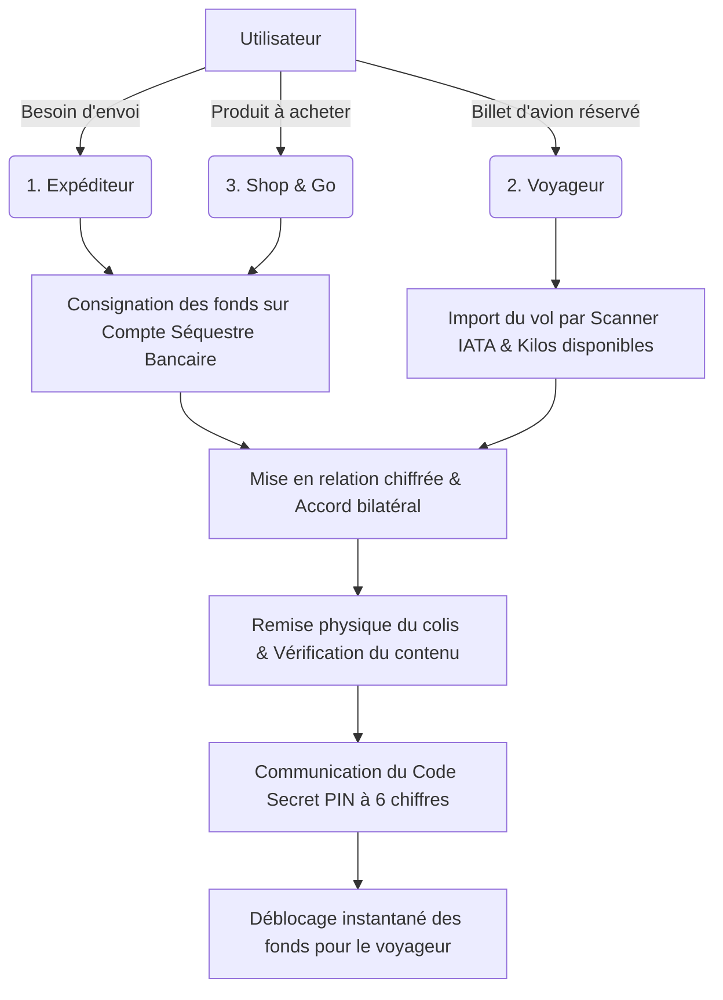

# BagVoyage — Plateforme Collaborative de Co-colisage & Shop & Go

**La plateforme collaborative internationale de transport aérien de colis et d'achats Shop & Go par voyageurs vérifiés.**

[Télécharger le Dossier Client PDF (12 pages, 2.3 Mo)](./BagVoyage_Dossier_Client.pdf) • [Architecture SEO Dédiée](#5-architecture-seo--pages-dédiées) • [Grille Tarifaire](#7-grille-tarifaire--comparatif-marché)

---

## Sommaire

1. [Présentation & Proposition de Valeur](#1-présentation--proposition-de-valeur)
2. [Design System Apple Pro : Desktop & Mobile (Clair / Sombre)](#2-design-system-apple-pro--desktop--mobile)
3. [Les 3 Parcours Utilisateurs](#3-les-3-parcours-utilisateurs)
4. [Fonctionnalités Avancées & Moteurs Embarqués](#4-fonctionnalités-avancées--moteurs-embarqués)
5. [Architecture SEO & Pages Dédiées](#5-architecture-seo--pages-dédiées)
6. [Back-office Admin & Outils Financiers](#6-back-office-admin--outils-financiers)
7. [Grille Tarifaire & Comparatif Marché](#7-grille-tarifaire--comparatif-marché)
8. [Architecture Technique & Stack](#8-architecture-technique--stack)
9. [Vérifications & Validation Qualité](#9-vérifications--validation-qualité)

---

## 1. Présentation & Proposition de Valeur

BagVoyage résout le défi du coût prohibitif et de la lenteur du fret express traditionnel (DHL, FedEx, UPS) sur les corridors internationaux (Europe, France–Algérie, Canada, Moyen-Orient, Afrique) en exploitant les franchises bagages aériennes inexploitées.

- **Expéditeur** : Expédie des colis volumineux ou urgents dès **8 €/kg** (**jusqu'à 70% d'économie** par rapport à DHL) avec remise en mains propres en moins de 48h.
- **Voyageur** : Monétise ses kilos disponibles et perçoit **85% nets** du montant de la transaction (jusqu'à 250 € par voyage), amortissant son billet d'avion.
- **Acheteur Shop & Go** : Commande des produits spécifiques indisponibles localement, achetés en boutique par un voyageur de confiance avec ticket de caisse certifié.

---

## 2. Design System Apple Pro : Desktop & Mobile

Conçue selon les standards d'Apple (Human Interface Guidelines), l'interface offre une typographie SF Pro nette, une aération maximale pour mobile, et un **Mode Sombre (Dark Mode)** immersif.

### A. Landing Page Principale (Desktop)

| Mode Clair (Light) | Mode Sombre Apple Pro (Midnight Slate `#0b0f19`) |
| :---: | :---: |
|  |  |

### B. Expérience Mobile (iPhone 15 Pro)

Zone tactile ergonomique, barre basse translucide en verre dépoli (`backdrop-filter: blur(20px)`), et micro-vibrations haptiques.

| Mobile Vue Claire | Mobile Vue Sombre |
| :---: | :---: |
|  |  |

---

## 3. Les 3 Parcours Utilisateurs

---

## 4. Fonctionnalités Avancées & Moteurs Embarqués

### A. Scanner de Billets IATA & Cartes d'Embarquement (OCR)
Reconnaissance optique embarquée (Tesseract.js local). Le voyageur dépose son billet PDF ou image : extraction confidentielle des détails du vol sans fuite de données personnelles.

### B. Radar Aérien Interactif en Temps Réel
Visualisation cartographique des corridors aériens (Paris-Orly, Marseille, Lyon vers Alger, Oran, Constantine, Montréal, Dakar).

| Radar Aérien Desktop | Radar Aérien Mobile |
| :---: | :---: |
|  |  |

### C. Séquestre Bancaire & Déblocage par Code PIN 6 Chiffres
L'argent de l'expéditeur reste cantonné sur un compte séquestre européen sécurisé. **Le voyageur ne perçoit son paiement qu'une fois le code PIN secret à 6 chiffres validé lors de la remise en main propre.**

### D. Suivi d'Expédition GPS & Timeline en Direct
Suivi transparent étape par étape (Consigné -> Pris en charge -> Vol en cours -> Arrivé -> Livré).

### E. Authentification Sécurisée & Vérification d'Identité KYC
Validation stricte des pièces d'identité officielles (Passeport / CNI) avec conformité réglementaire.

---

## 5. Architecture SEO & Pages Dédiées

Pour alléger la page d'accueil sans sacrifier le référencement naturel, 4 univers d'atterrissage indépendants ont été développés et pré-rendus statiquement (SSG) :

| Page | Aperçu Écran | Rôle & Contenu |
| :--- | :---: | :--- |
| **Comment ça marche** `/comment-ca-marche` |  | Déroulé pas-à-pas illustré pour les 3 rôles (Expéditeur, Voyageur, Shop & Go). |
| **Tarifs & Simulateur** `/tarifs` |  | Simulateur interactif de prix par corridor (dès 8 €/kg) et comparateur direct DHL (-70%). |
| **Sécurité & Confiance** `/securite` |  | Piliers de confiance : Séquestre, KYC, Code PIN et Convention de Montréal. |
| **Centre d'Aide & FAQ** `/faq` |  | Moteur de recherche instantané et balisage sémantique Schema.org `FAQPage`. |

---

## 6. Back-office Admin & Outils Financiers

### A. Centre de Contrôle Administrateur & Médiation
Supervision en direct de la marketplace, résolution des litiges, remboursements atomiques instantanés et audit financier immuable.

### B. Convertisseur Multi-Devises en Temps Réel
Conversion instantanée EUR / DZD / CAD / USD aux taux officiels et interbancaires.

### C. Module de Publication d'Annonces
Téléversement photos, dimensions, dates flexibles et déclaration douanière interactive.

---

## 7. Grille Tarifaire & Comparatif Marché

| Critère Analysé | BagVoyage | Fret Express (DHL / FedEx) | Groupes Informels Réseaux Sociaux |
| :--- | :---: | :---: | :---: |
| **Tarif moyen 5 kg (Paris–Alger)** | **40 €** (8 €/kg) | **145 €** (+260%) | 50 € - 75 € |
| **Délai d'acheminement** | **24h à 48h** | 3 à 5 jours ouvrés | Aléatoire (1 à 3 semaines) |
| **Protection des fonds** | **Séquestre bancaire certifié** | Assurance payante en option | **Aucune** (Arnaques fréquentes) |
| **Validation de la remise** | **Code secret PIN 6 chiffres** | Signature simple | Aucune preuve |
| **Contrôle d'identité** | **Vérification KYC officielle** | Expéditeur uniquement | Anonymat / Profils non vérifiés |
| **Cadre juridique** | **Convention de Montréal** | Fret aérien cargo | **Risque douanier et saisie** |
| **Rémunération voyageur** | **85% reversés** | 0 € | Risque de non-paiement |

---

## 8. Architecture Technique & Stack

- **Frontend** : React 18, TypeScript 5, Vite 5, Tailwind CSS, Lucide Icons.
- **Rendu & SEO** : Pré-rendu statique SSG multilingue (Français & Anglais) via `scripts/prerender.mjs`.
- **Thème** : Context React dynamique avec détection du schéma système (`prefers-color-scheme: dark`) et persistance `localStorage`.
- **Intelligence Embarquée** :
  - `Tesseract.js` pour la reconnaissance de caractères (OCR) des billets d'avion.
  - `jsQR` & `qrcode` pour la génération et lecture des pass de remise sécurisée.
  - Moteur d'arbitrage de rentabilité par corridor.
- **Accessibilité & Qualité** : Zéro emoji Unicode (conformité Apple Pro), balisage sémantique WAI-ARIA complet.

---

## 9. Vérifications & Validation Qualité

1. **Compilation TypeScript** : `npx tsc --noEmit` -> **0 erreur**.
2. **Audit Zéro Emoji** : Script d'analyse Regex `\p{Extended_Pictographic}` sur `src/` -> **0 emoji détecté**.
3. **Tests End-to-End Playwright** : `tests/admin-and-landing.spec.ts` -> **20/20 tests réussis**.
4. **Build de Production & SSG** : `npm run build` -> Toutes les routes HTML générées et optimisées dans `dist/`.
5. **Dossier Client PDF** : `BagVoyage_Dossier_Client.pdf` (12 pages A4 complètes générées et synchronisées).

---

BagVoyage International • Tous droits réservés • Document Technique & Commercial 2026

